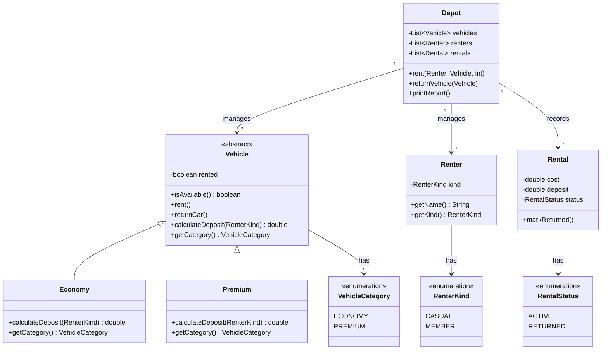
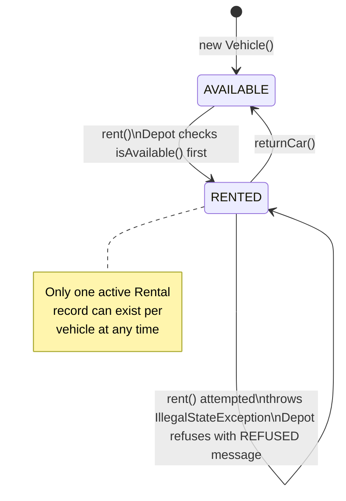

# Dovewing Car Rentals — Fleet and Rental Tracker

## Running the rebuilt program

**With Maven (compile only — no exec plugin configured):**
```bash
mvn compile
```

**Directly with the JDK (JDK 21 required):**
```bash
javac -d target/classes $(find src/main/java/dovewing -name "*.java")
java -cp target/classes dovewing.RentalTracker
```

**On Windows PowerShell:**
```powershell
javac -d target/classes (Get-ChildItem -Recurse src/main/java/dovewing -Filter "*.java" | Select-Object -ExpandProperty FullName)
java -cp target/classes dovewing.RentalTracker
```

---

## Original output (before any changes)

```
Rented Toyota Vitz (GT-1234-20) to Kofi Mensah for 3 days, cost GHS 450.0, deposit GHS 500.0
Rented Toyota Prado (GR-5678-22) to Ama Owusu for 2 days, cost GHS 1200.0, deposit GHS 0.0
Returned Toyota Prado (GR-5678-22)
Rented Toyota Vitz (GT-1234-20) to Ama Owusu for 2 days, cost GHS 300.0, deposit GHS 0.0

=== Dovewing Car Rentals - end of day ===
Fleet status:
  Toyota Vitz (GT-1234-20, ECONOMY): RENTED
  Toyota Prado (GR-5678-22, PREMIUM): AVAILABLE
Active rentals:
  Rental #1: GT-1234-20 -> Kofi Mensah (3 days)
  Rental #3: GT-1234-20 -> Ama Owusu (2 days)
```

Note the end-of-day report: one physical car, two active rental records. That
is the contradiction the paper backup exists to catch.

## Rebuilt output

```
Rented Toyota Vitz (GT-1234-20) to Kofi Mensah for 3 days, cost GHS 450.0, deposit GHS 500.0
Rented Toyota Prado (GR-5678-22) to Ama Owusu for 2 days, cost GHS 1200.0, deposit GHS 0.0
Returned Toyota Prado (GR-5678-22)
REFUSED: Toyota Vitz (GT-1234-20) is already rented - Ama Owusu's request cannot be processed.

=== Dovewing Car Rentals - end of day ===
Fleet status:
  Toyota Vitz (GT-1234-20, ECONOMY): RENTED
  Toyota Prado (GR-5678-22, PREMIUM): AVAILABLE
Active rentals:
  Rental #1: GT-1234-20 -> Kofi Mensah (3 days)
Completed returns:
  Rental #2: GR-5678-22 -> Ama Owusu (2 days, GHS 1200.0)
Financial summary:
  Revenue from completed rentals : GHS 1200.0
  Deposits held (active rentals) : GHS 500.0
  Total                          : GHS 1700.0
```

All legitimate transactions produce identical output. The double-rental is
refused with a clear message. The fleet report and rental list are consistent.

---

## Package structure

```
src/main/java/
  dovewing/
    model/
      VehicleCategory.java   enum  ECONOMY, PREMIUM
      RenterKind.java        enum  CASUAL, MEMBER
      RentalStatus.java      enum  ACTIVE, RETURNED
      Vehicle.java           abstract class — owns availability state
      Economy.java           extends Vehicle
      Premium.java           extends Vehicle
      Renter.java            renter with enum kind
      Rental.java            immutable transaction record
    Depot.java               fleet + rental operations
    RentalTracker.java       main entry point
```

---

## Class structure



---

## Vehicle availability state machine

The core invariant — a vehicle is either available or rented, never both, never rented twice.



---

## Key design decisions

### 1. Availability is owned by `Vehicle` behind a private field

The original had `Vehicle.status` as a public `String`. Any code could write
`v.status = "AVAILABLE"` and bypass every rule. The rebuilt version has a
private `boolean rented` and exposes only `isAvailable()`, `rent()`, and
`returnCar()`. The only way to change a vehicle's availability is through those
methods. `Vehicle.rent()` throws `IllegalStateException` if the vehicle is
already rented — so even if `Depot` forgot to check, the object refuses.

**Why this approach over a status enum on Vehicle:** a boolean is the exact
amount of state needed. "Is it available?" is a yes/no question. An enum would
add the same expressiveness but invite future misuse (someone could add
`MAINTENANCE`, changing the model without changing the enforcement). The
`getStatusLabel()` method returns the display string the report needs without
exposing the field.

### 2. Polymorphic vehicle classes instead of a branching switch

The original `rent()` had identical `ECONOMY` and `PREMIUM` branches. The
deposit calculation lives in subclasses via `calculateDeposit(RenterKind)`.
`Depot.rent()` calls it without knowing which category it is dealing with.

**Adding CommercialVan next quarter:**
- Add `COMMERCIAL_VAN` to `VehicleCategory` (one line).
- Write `CommercialVan extends Vehicle`, overriding `calculateDeposit()` with
  van-specific rules.
- Nothing in `Depot`, `Rental`, or `Renter` changes.

Under the original, adding a van meant a third copy-paste branch in `rent()` —
the same pattern that reportedly caused a pricing change in one category to
break behaviour in another.

### 3. Enums for all string sentinels

`RenterKind`, `VehicleCategory`, and `RentalStatus` replace the bare strings
`"CASUAL"`, `"MEMBER"`, `"ECONOMY"`, `"PREMIUM"`, `"ACTIVE"`, `"RETURNED"`.
A typo now fails at compile time rather than silently falling through a branch
and producing a rental with zero cost and no status change.

### 4. `Depot.rent()` checks availability and refuses clearly

The guard is in `Depot.rent()` and is backed by `Vehicle.rent()`. Two layers:
the depot refuses before touching anything, and the vehicle refuses at the state
transition itself. The refusal is printed as `REFUSED: ...` so front-desk staff
see exactly what happened and why.

---

## One improvement beyond the brief: end-of-day financial summary

The original report showed fleet status and a list of active rentals — nothing
else. At the end of a working day the owner had no way to see what the tool
had actually earned, what deposits were being held, or whether the day balanced,
without counting manually or keeping the paper backup open.

The rebuilt report adds two new sections:

**Completed returns** — every rental closed today, with the vehicle, renter,
duration, and cost collected. This is the record of money that actually changed
hands.

**Financial summary** — three lines:
- Revenue from completed rentals (cost collected on returned vehicles)
- Deposits held on active rentals (money held, not yet earned)
- Total cash position for the day

```
Completed returns:
  Rental #2: GR-5678-22 -> Ama Owusu (2 days, GHS 1200.0)
Financial summary:
  Revenue from completed rentals : GHS 1200.0
  Deposits held (active rentals) : GHS 500.0
  Total                          : GHS 1700.0
```

**Why this matters for the business:** the paper backup exists because the
tool cannot be trusted. One reason staff kept it was to cross-check the money
at the end of the day. A tool that tells you only which cars are out — but not
what you earned today — is incomplete as a business tool. This section gives
the owner what they need to close out the day without a second system.

**Why it is safe to add:** because `Rental` already stores `cost` and
`deposit` as final fields set at creation time. The summary is a pure read over
existing data — no new state, no new mutation paths, nothing that could
introduce the kind of inconsistency the rebuild was designed to eliminate.

---

## Diagnosis

See `DIAGNOSIS.md` for the full written diagnosis committed before any code
changes, including the design sketch (`design-sketch.svg`).
